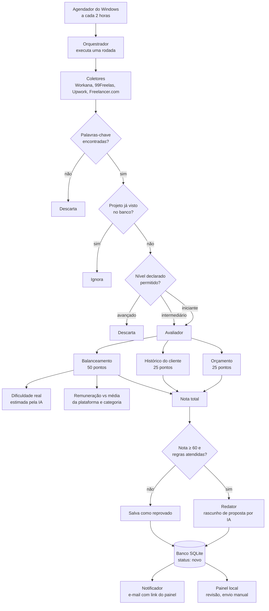
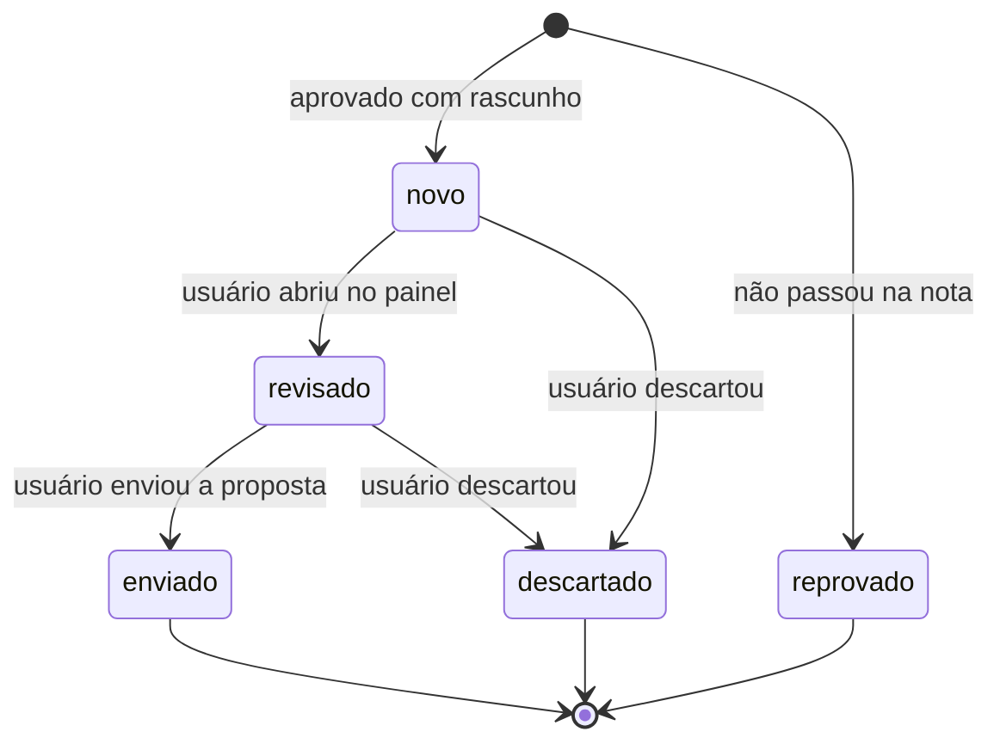

# Mapa do projeto: bot de busca e avaliação de projetos freelancer

Referência: `/home/claude/docs/superpowers/specs/2026-11-08-freelance-bot-design.md`

## 1. Visão geral do fluxo



## 2. Módulos

| Módulo | Responsabilidade | Depende de |
|---|---|---|
| **config** | Palavras-chave, limites de orçamento, pesos da nota, intervalo, caminhos, credenciais de SMTP (arquivo local fora do código) | nenhum |
| **coletores** | Um coletor por plataforma. Lê as listagens e devolve projetos no mesmo formato | config, navegador ou biblioteca HTTP |
| **filtro_nivel** | Descarta avançado; deixa intermediário passar só com as condições da seção 4 da especificação | config |
| **cambio** | Cotação do dia para comparar R$ e US$ | fonte de cotação (a definir) |
| **media_mercado** | Calcula a média de remuneração por plataforma e categoria a partir dos projetos vistos | banco |
| **avaliador** | Calcula as três partes da nota: orçamento, histórico do cliente e balanceamento | cambio, media_mercado, IA |
| **nota** | Soma as partes, aplica as regras de aprovação e o limite de 60 | avaliador |
| **redator** | Gera o rascunho da proposta com evidências do portfólio, no idioma da plataforma | IA, dados do portfólio |
| **portfolio** | Dados do usuário: sistema KYTEC, repositórios do GitHub, histórico do currículo | arquivos locais |
| **armazenamento** | Banco SQLite: projetos, notas, critérios, rascunhos e status | nenhum |
| **painel** | Página local com a lista de projetos, notas e rascunhos. Permite marcar como revisado, enviado ou descartado | armazenamento |
| **notificador** | Envia e-mail via SMTP do Gmail quando há projetos aprovados | config, armazenamento |
| **orquestrador** | Executa uma rodada completa, na ordem do fluxo acima | todos os módulos |
| **agendador** | Tarefa do Windows que chama o orquestrador a cada 2 horas | orquestrador |

## 3. Estados de um projeto



## 4. Dependências externas

- **Plataformas:** Workana, 99Freelas, Upwork e Freelancer.com (leitura das listagens)
- **IA:** estimativa de dificuldade real e escrita dos rascunhos
- **Cotação de câmbio:** fonte a definir
- **Gmail SMTP:** envio do e-mail com senha de app
- **Agendador de Tarefas do Windows:** dispara a execução

## 5. Estrutura de pastas sugerida

```
freelance-bot/
├── config/          # palavras-chave, limites, pesos e caminhos
├── coletores/       # um arquivo por plataforma
├── avaliacao/       # filtro_nivel, cambio, media_mercado, avaliador, nota
├── redacao/         # redator e portfolio
├── dados/           # armazenamento e SQLite
├── painel/          # servidor local e páginas
├── notificacao/     # notificador
├── orquestrador.py  # ponto de entrada de uma rodada
└── agendar.ps1      # registra a tarefa no Windows
```

## 6. Pontos que dependem de teste real

- Se cada plataforma permite a leitura das listagens sem bloqueio
- Precisão da estimativa de dificuldade feita pela IA
- Precisão da estimativa de horas em projetos de preço fixo
- Fonte e frequência da cotação de câmbio
